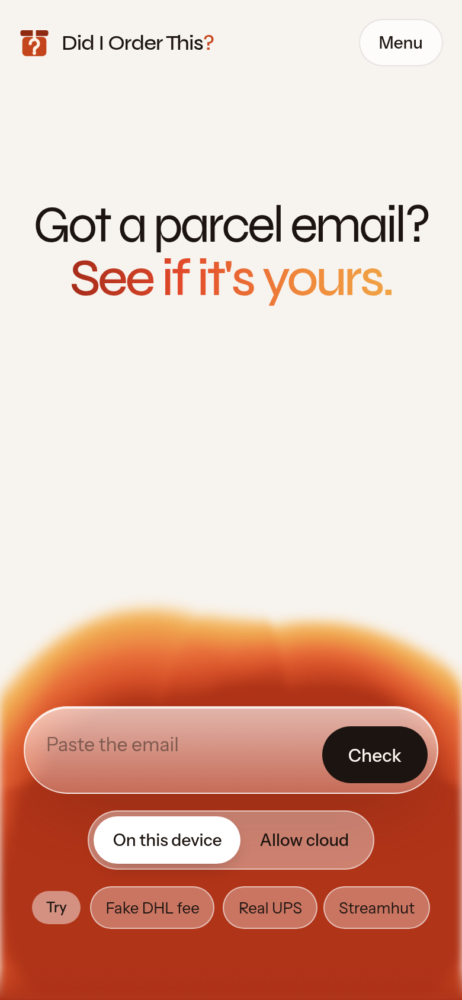
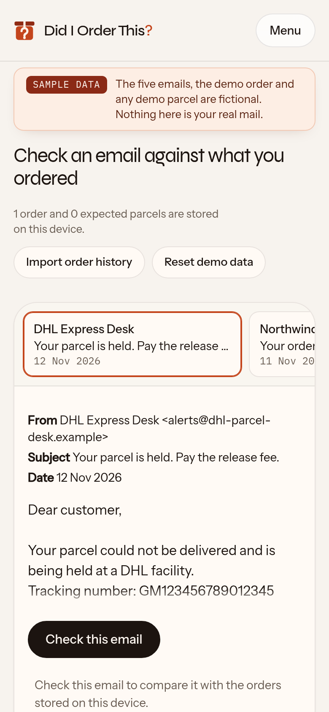
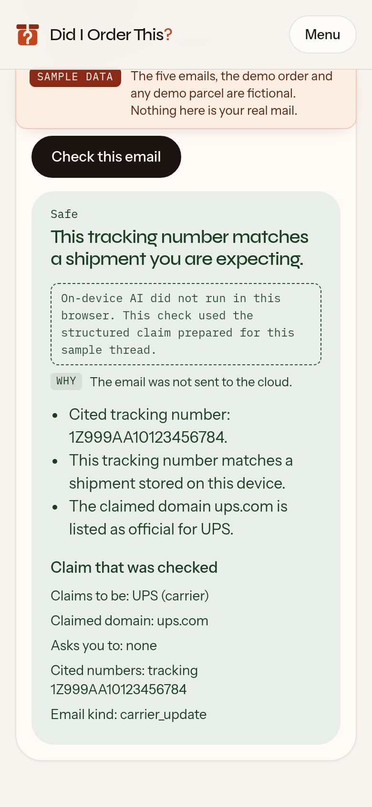

# Did I Order This?

**For judges:** open the [sample inbox](https://did-i-order-this.vercel.app/app/), click the first thread (**DHL Express Desk**, **Your parcel is held. Pay the release fee.**), click **Check this email**, and read the verdict: **You're not expecting any parcel right now.** Then click **Load the matching shipment demo** and check the UPS email: **This tracking number matches a shipment you are expecting.** No login.

<p align="center">
  
</p>

<p align="center"><strong>Check a delivery or billing email against the orders and tracking numbers on your own device, before you click.</strong></p>

A parcel or billing email can ask you to pay a fee or open a link, and a fake DHL or UPS message can look like a real one. This app uses Firebase AI Logic to read what the email claims, then plain code checks that claim against the orders and tracking numbers stored on your device.

## Quick Links

| What | Time and what it needs |
| --- | --- |
| [Try the sample inbox](#try-it) on the live site | 5 clicks, 0 minutes setup, no account, no install |
| Watch the film: `TBD-post-build: film URL (YouTube, at most 3 minutes, not filmed yet)` | At most 3 minutes (the hackathon limit) |
| [Live site](https://did-i-order-this.vercel.app) | Any browser, no account |
| [Judge extension zip](https://did-i-order-this.vercel.app/downloads/did-i-order-this-extension-0.1.0.zip) and its [test page](https://did-i-order-this.vercel.app/extension-demo/) | 3 steps, desktop Chrome 138 or later, Developer mode ([how](#more-ways-to-test)) |
| [One-command check](#more-ways-to-test): `npm ci` then `npm run verify` | About 31 seconds on the build machine, Node 22.22 or later |
| [How It Compares](#how-it-compares) with Gmail, Google Messages, Norton Genie, Bitdefender Scamio and Malwarebytes Scam Guard | One table |
| [Step-by-step testing guide](docs/TESTING.md) with every on-screen string | Reference |
| [Tracks and judging criteria](#tracks), [how it was built](#built-during-buildhybridai-2026) | Reference |

## Try It

**5 clicks, 0 minutes setup.** This is the live app at [did-i-order-this.vercel.app/app](https://did-i-order-this.vercel.app/app/). No account and nothing to install. It starts with demo data: **1 order and 0 expected parcels are stored on this device.** If the count is different, click **Reset demo data**.

1. Click the first thread, **DHL Express Desk**, **Your parcel is held. Pay the release fee.** (on a phone the threads are one row you can swipe), then **Check this email**.
2. In Chrome with on-device AI (Gemini Nano) there is no dialog. Everywhere else (for example phones, Firefox, Safari, or desktop Chrome without Nano) a dialog asks **Check this email in the cloud?** and says the cloud uses Google's free Gemini tier, so Google may keep this text and people at Google may review it. Click **Check in the cloud** or **Do not send**.
3. You see **Warning** and **You're not expecting any parcel right now.** The line under it says how the email was read:
   - **Checked on this device** or **Checked in the cloud** when the AI read it.
   - **On-device AI did not run in this browser. This check used the structured claim prepared for this sample thread.** when you clicked **Do not send**, or the cloud check could not run (a second line then says why, for example App Check or a timeout). This is a prepared claim, not an AI read, so it has no source label.
4. Click **Load the matching shipment demo**. The header now says **1 order and 1 expected parcel are stored on this device.** and the UPS thread opens.
5. Click **Check this email**: **Safe** and **This tracking number matches a shipment you are expecting.** After a cloud yes, sample threads in the same tab do not ask again.

You just saw the same kind of carrier email fail or pass only because of what is stored on this device, not because of scary wording.

**Two more threads, 2 clicks each:** **Duty payment required for your shipment** gives **This tracking number is not one of your shipments.** **Streamhut Billing** gives **Neutral** and **You have no history with this sender.** **Reset demo data** puts everything back. Every path, including paste, import, the homepage chips, and the extension test page, is in [docs/TESTING.md](docs/TESTING.md).

**How long before the dialog:** in desktop Chrome with the on-device API but no model, it appeared in under 0.1 seconds when the page had been open for 13 seconds, and in about 11 seconds when **Check this email** was clicked straight after the page loaded ([measured](docs/TESTING.md#how-long-before-the-dialog)).

## Proof It's Real

- **On-device run on the current build:** [nano-film run 44012648772](https://github.com/ohjay-official/nano-film/actions/runs/44012648772) (17 Nov 2026, 04:47 to 04:53 Africa/Lagos, production `3ad9c8c`; later commits change docs only) loaded the live `/app/` page in Chrome 157.0.8103.50 with Gemini Nano and got **Checked on this device** (`inferenceSource` `on_device`), **Warning**, **You're not expecting any parcel right now.**, and no cloud consent.
- **Extension on-device run:** [nano-film run 44009272463](https://github.com/ohjay-official/nano-film/actions/runs/44009272463) (17 Nov 2026, 04:18 to 04:23 Africa/Lagos, production `598cf21`; the extension, core and AI code have not changed since) loaded the live judge zip unpacked, opened the side panel on a local Gmail-thread fixture, and got **Checked on this device** (`on_device`), the same headline, and no cloud consent.
- **Cloud check on real devices, 17 Nov 2026:** a Galaxy S25 in Chrome Android and in the Telegram and X in-app browsers, and iPad Safari (WebKit, desktop layout), each showed **Checked in the cloud** with the expected verdicts. iPhone Safari itself was not run. Details are in the fold below.
- **Tests:** 164 unit tests (core 66, web 85, extension 13); `npm test` ran them in about 2.5 seconds on 17 Nov 2026 (Africa/Lagos). Core coverage: 96.95% statements (446/460) and 89.61% branches (345/385), gated at 95% and 85% in `packages/core/vitest.config.ts`.
- **CI:** `.github/workflows/ci.yml` runs `npm run verify -- --offline` on every push to `main` and on pull requests.
- **Lighthouse** (12.8.2, mobile, production `fcbfb0c`, 17 Nov 2026, 05:03 to 05:05 Africa/Lagos): Accessibility, Best Practices and SEO 100 on all 9 routes; Performance 98 to 100 on all 9 (home 98, Total Blocking Time 7 ms).
- **No real users yet.** Three testers are planned for 26 to 28 Nov 2026.

<details>
<summary><strong>Earlier runs, what Nano returned, and the full device notes</strong></summary>

- **Earlier on-device site runs:** [44009266512](https://github.com/ohjay-official/nano-film/actions/runs/44009266512) (17 Nov, `598cf21`), [43968899989](https://github.com/ohjay-official/nano-film/actions/runs/43968899989) (16 Nov, `f87d165`, after one runner that could not start Nano, [43967837755](https://github.com/ohjay-official/nano-film/actions/runs/43967837755)), [43950308139](https://github.com/ohjay-official/nano-film/actions/runs/43950308139) (16 Nov, `9c6e0cc`), [43947306478](https://github.com/ohjay-official/nano-film/actions/runs/43947306478) (16 Nov, `9098021`), [43682923396](https://github.com/ohjay-official/nano-film/actions/runs/43682923396) (15 Nov) and [43219012008](https://github.com/ohjay-official/nano-film/actions/runs/43219012008) (12 Nov). Run 44012648772 also confirms the film selectors still work after the desktop scroll change.
- **Why a separate repo:** private 2 vCPU runners cannot run Nano, so the proof runs from the public `ohjay-official/nano-film` repo; this repo keeps a copy of the workflow at `.github/workflows/on-device-demo.yml`.
- **Earlier extension runs:** [43967844787](https://github.com/ohjay-official/nano-film/actions/runs/43967844787) (16 Nov, `f87d165`), [43952581780](https://github.com/ohjay-official/nano-film/actions/runs/43952581780) (16 Nov, `9c6e0cc`, after one runner that could not start Nano, [43950314547](https://github.com/ohjay-official/nano-film/actions/runs/43950314547)), [43947314820](https://github.com/ohjay-official/nano-film/actions/runs/43947314820) (16 Nov) and [43685102643](https://github.com/ohjay-official/nano-film/actions/runs/43685102643) (15 Nov). The runner adds `http://127.0.0.1:8123/*` to the installed manifest's content script matches because it cannot sign into Gmail; the JavaScript in the zip is unchanged.
- **What Nano actually returned** in run 43947306478: the display name **DHL Express Desk** as the domain and the fee **$2.99** as the only cited number, missing the tracking number. The verdict was still right because the claim said carrier and no parcel was expected. Since then, `reconcileClaim()` in `packages/core/src/reconcile.ts` fills both gaps from the email text in code (sender domain from the From line, tracking-shaped numbers from the body), so the UPS match no longer depends on the model spotting the number. In run 43950308139, on the build with `reconcileClaim()`, the checked claim showed the domain `dhl-parcel-desk.example` and the tracking number GM123456789012345.
- **Galaxy S25, Chrome Android** (production `db64fcc`): the first DHL thread after **Check in the cloud** showed **Warning**, **You're not expecting any parcel right now.**, **Checked in the cloud**, and **Ask me each time**. After **Load the matching shipment demo**, the UPS thread showed **Safe**, **This tracking number matches a shipment you are expecting.**, **Checked in the cloud**, with no second consent dialog.
- **Telegram and X in-app browsers on that phone** (after UI-NEXT 11 and 12, `598cf21`): each checked the first DHL thread with the demo shipment already stored and showed **Warning**, **This tracking number is not one of your shipments.**, **Checked in the cloud**, the **SAMPLE DATA** tag on the verdict card, and **Ask me each time**. The model-filled claim text varied (Telegram: **Claims to be: DHL (carrier)**, **Email kind: carrier_update**; X: **Claims to be: DHL Express Desk (carrier)**, **Email kind: delivery_problem**); the verdict was the same, because code decides it.
- **iPad Safari** (iPadOS, desktop layout, about 04:35, before UI-NEXT 14): after Reset, first DHL **Warning**, **You're not expecting any parcel right now.**, **Checked in the cloud**, **Ask me each time**, and the matching-shipment loader; then UPS **Safe**, **This tracking number matches a shipment you are expecting.**, **Checked in the cloud**, **1 order and 1 expected parcel**. Oh-Jay scrolled the verdict into view by hand, so that walk does not prove desktop auto-scroll. It is still a WebKit cloud pass.
- **Build machine:** its automated Chrome is rejected by App Check (reCAPTCHA Enterprise) and then shows the prepared-claim note.
- **Lighthouse notes:** run from the build machine. `/how-it-works/` was run a second time after a Lighthouse trace error (`NO_NAVSTART`) and scored 99. On 16 Nov the home page had scored 80 and `/features/` Accessibility 91; both were fixed by the UI owner.

</details>

## What's New Here

**The AI does not judge the email.** Firebase AI Logic reads what the email claims (who it says it is from, what it wants you to do, which number it cites). Plain code then checks that claim against the orders and tracking numbers stored on your device.

This is for people who get a delivery or billing email that asks them to pay or click, and who want to check that claim without sending their inbox to a server. No usage numbers yet.

- **A fake parcel-fee email fails because you are not expecting a parcel.** The headline is exactly **You're not expecting any parcel right now.** when the email claims to be a carrier and no expected shipment is stored.
- **On-device first, cloud only after consent.** The hosted site tries `InferenceMode.ONLY_ON_DEVICE`, then asks before any `ONLY_IN_CLOUD` call. The extension never calls the cloud.
- **The source is labelled, not guessed.** Every result shows **Checked on this device**, **Checked in the cloud**, **Limited check (no AI)**, or **Check not completed**. The first two come from `result.response.inferenceSource`.

## How It Compares

The closest free tools people already use for a suspicious message, as their own pages describe them on 17 Nov 2026. "Not stated" means the linked page does not say.

| Product | Checks the email against your own orders and tracking numbers | Where the message is read | Cost and sign-in | Open source | What it covers |
| --- | --- | --- | --- | --- | --- |
| **Did I Order This?** | Yes, in code (`packages/core/src/verdict.ts`) | On your device (Gemini Nano in Chrome). The cloud only after you click **Check in the cloud**; the extension never uses it | Free, no account | Yes, Apache-2.0 | Delivery and billing emails: sample inbox, paste, Gmail side panel (sideloaded) |
| Gmail's built-in protection ([Safety Center](https://safety.google/intl/en_us/products/gmail/)) | Not stated | In Gmail, before mail reaches your inbox | Comes with a Gmail account | Not stated | All Gmail mail: blocks spam, phishing and malware, warns on links and attachments |
| Google Messages Scam Detection ([announcement](https://blog.google/security/new-ai-powered-scam-detection-features/), [privacy help](https://support.google.com/messages/answer/9327903?hl=en), [Enhanced mode](https://blog.google/security/new-android-scam-protections/)) | Not stated | On the device in standard mode; the opt-in Enhanced mode also uses cloud Gemini in Private AI Compute | Built into Google Messages, on by default for non-contacts | Not stated | SMS, MMS and RCS texts |
| Norton Genie ([FAQ](https://support.norton.com/sp/en/us/home/current/solutions/v20230717145233467), [privacy notice](https://us.norton.com/privacy/products-privacy-notice)) | Not stated | You paste or upload it to Genie; Norton keeps submissions for 30 days | Free; sign-in not stated | Not stated | Texts, emails, social posts and websites, on the web, iOS and Android |
| Bitdefender Scamio ([product page](https://www.bitdefender.com/en-us/consumer/scamio), [terms, section 4.5](https://www.bitdefender.com/en-us/site/view/subscription-agreement-and-terms-of-services-for-home-user-solutions)) | Not stated | You send it to the Scamio chatbot | Free, Bitdefender account required, 5 checks a day | Not stated | Texts, emails, links, QR codes and images, on the web, WhatsApp, Messenger and Discord |
| Malwarebytes Scam Guard ([product page](https://www.malwarebytes.com/solutions/scam-guard)) | Not stated | You share it with Scam Guard; queries are stored locally for 30 days | Free ("our free scam detector"), also listed in Premium Security; sign-in not stated | Not stated | Numbers, texts, emails, URLs and images, on Windows, Mac, iOS, Android and Browser Guard |

**Why it stands out:**

- **It answers a different question.** The tools above judge the message itself (its wording, links and known threats). This one asks whether the claim matches something you actually ordered or are expecting, so a perfectly worded fake still fails when no parcel is expected.
- **The email stays on your device unless you say yes.** Cloud reading is a separate, asked-for step, and every result says where it was read.
- **Code decides, not the model.** The verdict comes from `decideVerdict()`, so it is the same however the model words the claim (see the Telegram and X runs in [Proof](#proof-its-real)).
- **Open and free.** Apache-2.0, no account.

**Where the others are stronger:** they cover far more (texts, calls, links, QR codes, social posts and websites), Gmail and Google Messages protect automatically without a manual check, and they draw on large threat databases and years of use. This app covers only delivery and billing emails, needs your orders or shipments stored on the device, and its on-device AI needs desktop Chrome with Gemini Nano.

## Tracks

Platform and prize category names are taken from the [#BuildHybridAI 2026](https://firebasehybridaihackathon.devpost.com/) rules. The official rules do not use Q-style requirement ids.

| Track or criterion | What qualifies | Where to check |
| --- | --- | --- |
| Platform: Web (Chrome) | Hosted web app plus a Chrome MV3 side-panel extension | [Live site](https://did-i-order-this.vercel.app), `extension/` |
| Prize category: Best Web/Chrome | Same as the platform above | Live site, judge zip, this README |
| Technological Implementation | Firebase AI Logic hybrid inference, structured output, App Check | [How Firebase AI Logic Is Used](#how-firebase-ai-logic-is-used), `web/src/ai/readClaim.ts` |
| Design | A complete sample-inbox product, not only a probe | [Try It](#try-it), live `/app/` |
| Potential Impact | Check a delivery or billing claim against *your* on-device orders before you click | [What's New Here](#whats-new-here), [How It Compares](#how-it-compares) |
| Quality of the Idea | The model reads the claim; code issues the verdict | [What's New Here](#whats-new-here), `packages/core/src/verdict.ts` |

## What Works Today

| Feature | Status |
| --- | --- |
| Sample inbox with 5 threads and the full verdict flow | Works on the live site |
| Prepared-claim fallback on sample threads when on-device AI and the cloud are not used or fail | Works on the live site (walked 16 Nov 2026 in desktop Chrome at 1280 and 390 pixels) |
| **Load the matching shipment demo** after the first check | Works on the live site |
| On-device check through Firebase AI Logic (Gemini Nano in Chrome) | Works where Chrome's on-device model is available; proven on a public runner |
| Cloud check after consent | Works on the live site; recorded on a Galaxy S25 (Chrome, Telegram, X) and iPad Safari. iPhone Safari itself was not run |
| Remember a cloud yes for sample threads until the tab closes | Works; **Ask me each time** clears it. Pasted emails are always asked about |
| Limited check with no AI | Works |
| Paste your own email and check it | Works |
| Import order history (Amazon ZIP or CSV, PayPal CSV, generic CSV), parsed in the browser | Works |
| Save a shipment from a "your order has shipped" email | Works |
| Chrome extension side panel on an open Gmail thread | Works when sideloaded; on-device only. Proven on a public runner with a local Gmail-thread fixture, not a signed-in mail.google.com session |
| Chrome Web Store listing | Not done. Planned |
| Screenshots, `.eml` files, SMS or phone texts | Not supported |
| Outlook, Yahoo or other webmail in the extension | Not supported (Gmail only) |
| Account login emails | Out of scope by design |
| Real user numbers | None yet |

## More Ways to Test

Numbered from quickest to most real. None of these needs a Google or Firebase account. Times were measured on the build machine on 17 Nov 2026 (Africa/Lagos), from a fresh clone of `main` at `5a74a41` on Node 24.22.1 with a warm npm cache; a first install on a new machine downloads more and takes longer.

<details>
<summary><strong>1. Unit tests only (about 3 seconds after <code>npm ci</code>, Node 22.22 or later)</strong></summary>

```bash
npm ci
npm test
```

Runs 164 unit tests: core 66, web 85, extension 13. `npm ci` took about 5 seconds and `npm test` about 2.5 seconds.

</details>

<details>
<summary><strong>2. One command that checks everything (about 31 seconds, Node 22.22 or later)</strong></summary>

```bash
npm ci
npm run verify
```

`npm run verify` checks the Node version, then runs the unit tests, the core coverage gate, typecheck, lint, a guard that product code must not call Chrome's Prompt API directly, the web and extension builds, the extension zip, a secrets scan of tracked files and git history, a bundle scan for App Check debug tokens, a dependency audit, and live-site checks (routes, the zip, and security headers). Each line prints `PASS` or `FAIL`, and it exits non-zero on any failure. Measured: `npm ci` about 5 seconds plus `npm run verify` about 27 seconds, PASS on all 19 checks.

Without network access, `npm run verify -- --offline` skips the live-site checks (about 14 seconds; 13 passed, 1 skipped). CI runs it this way on every push and pull request.

</details>

<details>
<summary><strong>3. Run it locally or run your own (about 5 seconds to a dev server, Node 22.22 or later, no keys needed)</strong></summary>

```bash
npm ci
cp .env.example web/.env.local
npm run dev --workspace=web
```

Measured: `npm ci` about 5 seconds, then Vite served `http://localhost:5173/app/` in under half a second.

Environment variables, as names only (fill in `web/.env.local`, never commit values):

```
VITE_FIREBASE_API_KEY=<your Firebase web API key>
VITE_FIREBASE_AUTH_DOMAIN=<your-project.firebaseapp.com>
VITE_FIREBASE_PROJECT_ID=<your-project-id>
VITE_FIREBASE_STORAGE_BUCKET=<your-project.appspot.com>
VITE_FIREBASE_MESSAGING_SENDER_ID=<your-sender-id>
VITE_FIREBASE_APP_ID=<your-app-id>
VITE_FIREBASE_RECAPTCHA_SITE_KEY=<your reCAPTCHA Enterprise site key>
VITE_FIREBASE_RECAPTCHA_PROVIDER=enterprise
```

Do not put an App Check debug token in this file, in the repo, or in a shipped bundle.

Without the Firebase web config, the sample inbox still works: each sample thread falls back to the claim prepared for that thread, and the page says **On-device AI did not run in this browser. This check used the structured claim prepared for this sample thread.** Pasted emails fall back to the limited check. Without `VITE_FIREBASE_RECAPTCHA_SITE_KEY`, cloud AI is not offered.

</details>

<details>
<summary><strong>4. Sideload the Chrome extension (3 steps, desktop Chrome 138 or later)</strong></summary>

1. Download [did-i-order-this-extension-0.1.0.zip](https://did-i-order-this.vercel.app/downloads/did-i-order-this-extension-0.1.0.zip) and unzip it. Or build it yourself: `npm run package:extension` writes the zip to `extension/release/`.
2. Open `chrome://extensions`, turn on **Developer mode**, click **Load unpacked**, and pick the inner `did-i-order-this-extension` folder.
3. Open the [extension test page](https://did-i-order-this.vercel.app/extension-demo/) (labelled **Extension test fixture.**, not Gmail) or a Gmail thread at `mail.google.com`, open the side panel from the toolbar, then click **Check this email**.

Permissions: `storage` and `sidePanel` only, plus a content script on `https://mail.google.com/*`. The side panel runs `only_on_device`. Without Nano the panel shows **Error**, says this extension does not send mail to the cloud, offers **Run a limited check (no AI)**, and points to the hosted site. A signed-in Gmail thread was not tested on the build machine; the runner proof used a local Gmail-thread fixture.

</details>

<details>
<summary><strong>5. See the on-device path yourself (desktop Chrome on hardware that meets Chrome's built-in AI requirements)</strong></summary>

The hackathon FAQ says to open `chrome://flags`, search for **Gemma 4 for Built-in AI**, enable it, and relaunch. The runner proofs instead turn on `chrome://flags/#optimization-guide-on-device-model` and `chrome://flags/#prompt-api-for-gemini-nano`. `chrome://on-device-internals` shows whether the model is ready; it downloads the first time it is used, so the time depends on your connection (not measured). Then follow [Try It](#try-it): no dialog appears, and the result says **Checked on this device**. This was not tried on the build machine, which cannot run Nano.

</details>

## Screenshots

<p align="center">
  
  
  
  
</p>

<p align="center"><em>The live site on 17 Nov 2026 (Africa/Lagos), 390 pixels wide, with sample data. The two verdicts use the prepared sample claim (Do not send), not an AI read.</em></p>

A live on-device verdict could not be captured from the build machine (no Gemini Nano, and App Check rejects its automated browser); it is in the runner proof above. The cloud verdicts recorded on the Galaxy S25 and iPad stay off this repo because those screenshots include browser chrome, a status bar, or other open tab titles.

## What It Does

1. **Read the claim.** `readClaim()` in `web/src/ai/readClaim.ts` sends the email text to Firebase AI Logic and asks for four fields only: `claimed_party` (name, role, domain), `asked_action`, `cited_numbers`, and `email_kind`.
2. **Pick where it runs.** The first try is `only_on_device`. If that fails on the hosted site, the app asks for consent before any cloud call. If you click **Do not send**, the email is not sent. A sample thread then uses the claim prepared for it and says so; a pasted email offers a limited check with no AI.
3. **Fill gaps in code.** `reconcileClaim()` uses the From line's domain as the claimed domain and adds tracking-shaped numbers the model missed. It never removes what the model cited.
4. **Decide in code.** `decideVerdict()` in `packages/core/src/verdict.ts` is deterministic. Carrier emails are judged by the cited tracking number against expected parcels on the device. A stored tracking number in an email from a domain that is not the carrier's, asking you to pay, log in, or download, gets **Warning** and **This tracking number matches your shipment, but this email is not from the carrier's official domain.** Store and billing emails are judged by order numbers and sender history.
5. **Label the source.** The label comes from the SDK. If the SDK does not report a source, the read is treated as failed instead of guessed.

It cannot promise that an email is safe or is a scam. It can only say whether the claim matches the orders and tracking numbers stored on that device.

## How Firebase AI Logic Is Used

All of this is in code, imported from `firebase/ai` and `firebase/app-check`, and called at runtime. It is not only named here.

- **Calls:** `getAI` with `new GoogleAIBackend()`, `getGenerativeModel`, `initializeDeviceModel`, and `generateContent` in `web/src/ai/readClaim.ts`. The hosted site and the extension both call this same `readClaim()`.
- **Hybrid modes:** the app tries `InferenceMode.ONLY_ON_DEVICE` first. After consent, the hosted site calls `InferenceMode.ONLY_IN_CLOUD`. The visible label comes from `result.response.inferenceSource` (`InferenceSource.ON_DEVICE` or `InferenceSource.IN_CLOUD`).
- **Why not `PREFER_ON_DEVICE`:** it falls back to the cloud without asking. An email is personal, so the app keeps the device-only and cloud-only steps apart and puts the consent dialog between them, in line with the hackathon FAQ's advice to keep sensitive data on the device.
- **In code, but not chosen by the app:** `InferenceMode.PREFER_ON_DEVICE` is mapped in `readClaim.ts` and covered by tests (it spends the client cloud budget, because it may reach the cloud). The hosted site and the extension never select it.
- **Models:** cloud model `gemini-3.5-flash-lite`. On device, Chrome's Gemini Nano is requested as text-only (`expectedInputs` and `expectedOutputs` of type `text`, English).
- **Structured output:** `Schema.object` from `firebase/ai` (`web/src/ai/schema.ts`) is sent as `responseConstraint` on device and as `responseSchema` with `responseMimeType: "application/json"` in the cloud. One retry if the reply does not parse.
- **App Check:** `initializeAppCheck` with `ReCaptchaEnterpriseProvider` and `isTokenAutoRefreshEnabled: true` in `web/src/firebase/app.ts`. The AI Logic API rejects calls without a valid token (HTTP 401).
- **Not used:** this app does not import Firestore, Remote Config, or Authentication.

## Privacy

- Email stays on the device by default. Cloud is used only on the hosted site, only after the consent dialog, and only for the one email being checked. The dialog says: "The cloud uses Google's free Gemini tier, so Google may keep this text and people at Google may review it."
- Orders and tracking numbers are stored in IndexedDB (site) or `chrome.storage.local` (extension). There is no project server or database.
- Vercel Web Analytics and Speed Insights run on the production host only, cookie-free, with query strings stripped. See the [privacy policy](https://did-i-order-this.vercel.app/privacy/#policy).

## Security

- **App Check** (reCAPTCHA Enterprise) is enforced on the Firebase AI Logic API.
- **Spend and abuse limits:** the browser API key is restricted to `https://did-i-order-this.vercel.app/*`; the Firebase AI Logic quota is 10 requests per minute per user; billing is not linked, so nothing can bill; a client throttle allows 10 cloud reads a minute and 30 per tab session (`web/src/ai/cloudBudget.ts`), and a cloud read that does not answer in 20 seconds is stopped. The client throttle is a courtesy limit. It cannot stop a determined caller.
- **Headers:** a Content Security Policy that allows scripts only from this site and reCAPTCHA, plus HSTS, `X-Frame-Options: DENY`, `X-Content-Type-Options: nosniff`, a strict referrer policy, and a locked-down permissions policy (`vercel.json`). `npm run verify` found all 6 on the live site on 17 Nov 2026.
- **Input cap:** `readClaim()` sends at most the first 20,000 characters of an email to the model, on the site and in the extension.
- **Consent dialog keyboard:** focus starts on **Do not send**, Tab stays inside the dialog, and Escape means **Do not send**.
- **Extension:** the background worker accepts email text only from this extension's own content script on Gmail, caps it at 20,000 characters, and answers requests from inside the extension only. No Gmail API, no mailbox scan.
- **No secrets in the repo.** `.env.example` has empty values only. `npm run verify` scans tracked files and the full git history for API keys, tokens, private keys, and App Check debug tokens, and checks the built bundles for a debug token.
- **Dependencies:** `npm audit` reports 4 high advisories, all from `@grpc/grpc-js` inside the Firestore part of the `firebase` package. This app never imports Firestore, and the verify script checks that no grpc code is in the web bundle. There has been no third-party security audit.

**What it doesn't promise:** a passed check is not a guarantee the email is safe. A cloud check sends that one email to Google's free Gemini tier, which may keep it and may review it. On-device AI needs desktop Chrome with Gemini Nano available (Chrome's own hardware requirements apply). The extension reads Gmail on the web only, and is sideloaded; there is no Chrome Web Store listing yet. SMS, phone texts, screenshots, and `.eml` files are not covered. Account login emails are out of scope.

## Sustainability

There is no product server to run. Orders stay on the device. The site is hosted on Vercel. Cloud AI uses Google's free Gemini tier, and the Firebase project's billing is not linked. If work on the code stops, the live site stays up as long as the Vercel and Firebase projects remain. To run your own copy, see [More Ways to Test, step 3](#more-ways-to-test).

## Repository

<details>
<summary><strong>Folders and docs, one line each</strong></summary>

| Path | What it holds |
| --- | --- |
| `packages/core` | Verdict engine, ingest, order-history import, limited check |
| `web` | Vite multi-page site, the sample inbox, and the `/extension-demo/` test page |
| `extension` | Chrome MV3 side panel, content script, background worker |
| `e2e` | On-device filming run used by `nano-film` |
| `scripts` | `npm run verify` and the no-Prompt-API guard |
| `testdata` | Sample order-history files for the import paths in `docs/TESTING.md` |
| `.github/workflows` | CI and the on-device demo workflow |
| `docs/TESTING.md` | Do-this, see-this steps for judges and testers |
| `docs/VICTORY-TEST-2026-11-16.md` | The pre-submit test run: what passed, what was fixed, what is still open |
| `docs/images` | README screenshots of the live site |
| `docs/HANDOFF-ui.md`, `docs/UI-NEXT.md` | Internal UI handoff and the UI to-do list (all items done or noted), not user guides |

</details>

## Built During #BuildHybridAI 2026

**This is a new project. Every commit in this repository was written during the #BuildHybridAI 2026 submission period.**

**The first commit:** `d6b4d68`, 12 Nov 2026, 12:16:52 Africa/Lagos (UTC+1), which is 11:16:52 UTC. Message: "Scaffold the app and the core scam check." Check with:

```bash
git log --reverse --format='%h %ad %s' --date=iso | head -3
```

**Official requirements this answers.** Names are from the [official rules](https://firebasehybridaihackathon.devpost.com/rules) and [What to Submit](https://firebasehybridaihackathon.devpost.com/); there are no Q-style rule ids.

| Requirement | How it is met |
| --- | --- |
| What to Create / Web (Chrome) | A web app and a Chrome extension using Gemini Nano through Firebase AI Logic |
| Firebase AI Logic imported and called at runtime | See [How Firebase AI Logic Is Used](#how-firebase-ai-logic-is-used) |
| App Check | Required by the rules; reCAPTCHA Enterprise is enforced. Debug tokens are accepted in submissions; this project does not ship one |
| New project | All commits are inside the submission period. Earlier work reused is disclosed below: the on-device warm-up approach, supplied media, and parts of a CSS checklist |
| Value proposition, features, and instructions | The tagline and [What's New Here](#whats-new-here) (value), [What Works Today](#what-works-today) (features), [Try It](#try-it) and [More Ways to Test](#more-ways-to-test) (instructions), plus a hosted project URL (encouraged by the rules) |
| Open source license | Apache-2.0, the rules' preferred license, in the `LICENSE` file and shown in the GitHub About box |
| Demonstration video | Required on the Devpost form, at most 3 minutes, public on YouTube, in English. Its link goes in the film line under [Quick Links](#quick-links) |
| No production secrets in the repo, form, or testing instructions | `.env.example` uses placeholders only; `npm run verify` scans for secrets |

**AI code:** Grok Bot wrote the product code, the tests, the docs, and the verify pipeline, directed by Oh-Jay. Claude did the planning on 11 and 12 Nov 2026, and Claude Opus 5.5 landed the v7 UI commits on `main` on 15 Nov 2026 (`16fc66e`, `b1f076d`, `8bb5936`), the ten UI-NEXT commits on 16 Nov 2026 (`184f42f` to `f87d165`), and UI-NEXT 11, 12 and 14 on 17 Nov 2026 (`720cdbd`, `598cf21`, `352c69e`), each with a Co-Authored-By line; UI and UX work is Claude's. Oh-Jay chose the idea, wrote the product and design briefs, made the product decisions, and reviewed every build on his phone.

**Earlier work reused:** the on-device warm-up approach in `e2e/` follows Oh-Jay's own `nano-probe` test from 12 Nov 2026. Photos, the globe texture, the hands, and the freight clip are media files Oh-Jay supplied. The CSS follows parts of the unslop design checklist by Damir Sokolovsky (CC BY 4.0), credited in `web/src/styles-v6.css`.

**The live site will stay up through judging and after.** A scheduled check in the public `nano-film` repo ([`uptime.yml`](https://github.com/ohjay-official/nano-film/blob/main/.github/workflows/uptime.yml)) asks for `/`, `/app/`, `/extension-demo/` and the judge zip every 30 minutes through 16 Dec 2026 and fails if any is not 200. GitHub runs schedules on a best-effort basis; the first scheduled pass was [run 44012209331](https://github.com/ohjay-official/nano-film/actions/runs/44012209331) (17 Nov 2026, 04:43 Africa/Lagos).

### Libraries and Services, at Lockfile Versions

| Group | Packages and services |
| --- | --- |
| Runtime | firebase 13.2.0 (`firebase/ai`, `firebase/app-check`); three 0.160.0 (home-page globe); @vercel/analytics 2.0.1; @vercel/speed-insights 2.1.0; fflate 0.8.3 (order-history ZIPs, and packaging the extension zip) |
| Development only | vite 7.3.8; typescript 5.9.3; vitest 4.1.12; @vitest/coverage-v8 4.1.12; jsdom 31.0.0 (extension DOM tests); eslint 9.39.5; typescript-eslint 8.72.2; playwright-core 1.65.0 (pinned in `e2e/package-lock.json`, used by the on-device filming run) |
| Services | Firebase AI Logic with the Gemini Developer API (model `gemini-3.5-flash-lite` in the cloud, Gemini Nano on device); Firebase App Check with reCAPTCHA Enterprise; Vercel (hosting, production deploys from `main`, Web Analytics, Speed Insights); GitHub Actions (CI and the on-device runs) |

<details>
<summary><strong>Build log by day (from git history)</strong></summary>

- **12 Nov 2026 (12 commits):** core verdict engine and tests; order-history import, limited check, Chrome extension, and App Check providers; the on-device workflow and Nano warm-up; first multi-page site, rebuilt toward a live checker.
- **13 and 14 Nov 2026:** no commits.
- **15 Nov 2026 (15 commits, 3 of them Claude's UI):** v6 landing (globe, freight scroll, night footer) and VP9 video fallback; v6.1 real media and footer; v6.2 logo, favicons, per-page meta and OG images, JSON-LD, privacy policy, Vercel Analytics and Speed Insights, client cloud budget, contrast fixes, faster hero; backend pass: extension messaging checks and fewer permissions, judge zip, plain-language AI errors, the free-tier review notice on the consent dialog, CSP and security headers, lint, more tests with a coverage gate, `npm run verify`; README and the extension on-device proof citation; Claude's v7 UI commits.
- **16 Nov 2026:** judge-demo fixes (fail fast without an on-device model, client cloud cap raised to 10 a minute, tab-session memory for a cloud yes, the matching shipment demo loader, the prepared-claim fallback on sample threads, a 20-second cloud timeout, the `/extension-demo/` test page, `docs/TESTING.md`); Node 22.22 as the minimum; this README; the pre-submit test run and its fixes (lookalike-domain warning, claim gap filling, 20,000-character model input cap, consent dialog keyboard); a pre-submit QA pass that stopped a re-imported order history from adding duplicate orders and shipments, and fixed the privacy policy to name the real consent button; Claude's ten UI-NEXT commits (Sample data bar, swipeable thread row on phones, styled notes and focus ring, extension test page link and style, Real UPS chip note, `/features/` contrast, faster home page, consent mockups matching the real dialog); a fix so the homepage Real UPS chip keeps its demo shipment on a brand-new device.
- **17 Nov 2026:** Claude's UI-NEXT 11 and 12 (`720cdbd`, `598cf21`): after a check, the verdict card scrolls into view on phones (headline at y=153 of 844); the Sample data bar is no longer sticky on phones, and a SAMPLE DATA tag sits on the verdict card. A Galaxy S25 cloud walk in Chrome Android, then in the Telegram and X in-app browsers, recorded real **Checked in the cloud** verdicts, and iPad Safari (WebKit, desktop layout) did the same path, with the verdict scrolled into view by hand (item 14 had not landed yet). On-device proofs were re-run on production `598cf21` (nano-film 44009266512 and 44009272463) and again after UI-NEXT 14 (site run 44012648772 on `3ad9c8c`). UI-NEXT 14 (`352c69e`) brings the verdict into view on laptop-height windows too (at 1280 x 800, after **Do not send**, the DHL headline now sits at y=160; the same path was re-checked on the UPS and Streamhut threads and on a limited check). A README audit refreshed the Lighthouse and `npm run verify` numbers on production `fcbfb0c` and removed two unreferenced 15 Nov screenshots.

</details>

## License

[Apache-2.0](LICENSE). Built by Oh-Jay ([@ohjay-official](https://github.com/ohjay-official)).
