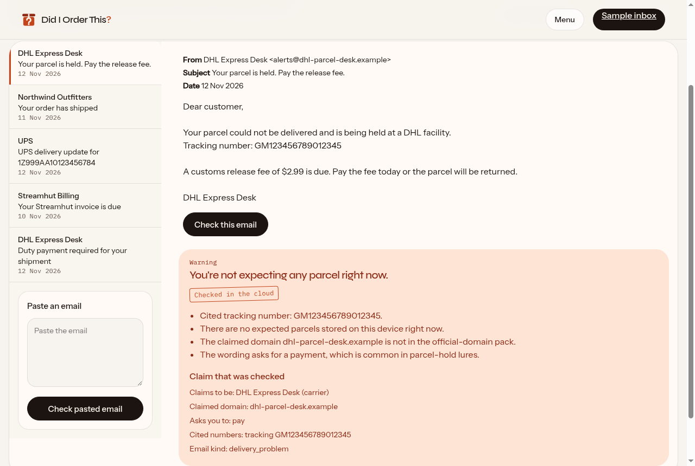

# Did I Order This?

**Check a delivery or billing email against the orders and tracking numbers on your own device, before you click.**



**For judges:** open the [sample inbox](https://did-i-order-this.vercel.app/app/), click the first thread (DHL Express Desk), click **Check this email**, and read the verdict. No login, no extension, about 30 seconds.

| Live demo | Demo film | Repo | Extension zip |
| --- | --- | --- | --- |
| [did-i-order-this.vercel.app](https://did-i-order-this.vercel.app) | `[PLACEHOLDER: demo film link, added after filming]` | [ohjay-official/did-i-order-this](https://github.com/ohjay-official/did-i-order-this) | [did-i-order-this-extension-0.1.0.zip](https://did-i-order-this.vercel.app/downloads/did-i-order-this-extension-0.1.0.zip) |

## What's new here

The AI does not judge the email. Firebase AI Logic reads what the email *claims* (who it says it is from, what it wants you to do, which number it cites), and plain code checks that claim against the orders and tracking numbers stored on your device. A fake parcel-fee email fails because you are not expecting a parcel, not because the wording looks scary.

## Try it in 30 seconds

Open <https://did-i-order-this.vercel.app/app/> in desktop Chrome. Nothing to install and no account. The page starts with demo data: one past order and no expected parcels ("1 order and 0 expected parcels are stored on this device.").

1. Click the thread **DHL Express Desk, "Your parcel is held. Pay the release fee."**, then **Check this email**.
2. If on-device AI is not available in your browser, a dialog asks **"Check this email in the cloud?"** Click **Check in the cloud** (or **Do not send**, then **Run a limited check (no AI)**).
3. With AI you see **Warning** and **"You're not expecting any parcel right now."** with a label: **Checked on this device** or **Checked in the cloud**. The limited check instead says "Limited check only. This is not a full verdict." and lists what it found.
4. Click **Northwind Outfitters, "Your order has shipped"**, check it, then click **Save this shipment**.
5. Click **UPS, "UPS delivery update for 1Z999AA10123456784"** and check it: **"This tracking number matches a shipment you are expecting."**
6. Click the second **DHL Express Desk** thread ("Duty payment required for your shipment"): **"This tracking number is not one of your shipments."**
7. **Reset demo data** puts everything back.

**Check everything with one command** (Node 22.22 or later):

```bash
npm ci
npm run verify            # tests, coverage gate, typecheck, lint, build, zip, secrets scan, audit, live-site links
npm run verify -- --offline   # same, without the live-site checks
```

It prints `PASS` or `FAIL` per check and exits non-zero on any failure.

## Proof it's real

- **On-device run on a public GitHub runner:** [nano-film run 43219012008](https://github.com/ohjay-official/nano-film/actions/runs/43219012008) (12 Nov) loaded the live `/app/` page in Chrome with Gemini Nano and got the label "Checked on this device". Re-run on 15 Nov after the security and error-handling changes: [nano-film run 43682923396](https://github.com/ohjay-official/nano-film/actions/runs/43682923396), Chrome 157, label "Checked on this device", headline "You're not expecting any parcel right now.", no cloud consent needed. The workflow is in `.github/workflows/on-device-demo.yml`; private 2 vCPU runners cannot run Nano, so the proof runs from the public `nano-film` repo.
- **Extension on-device run on a public GitHub runner:** [nano-film run 43685102643](https://github.com/ohjay-official/nano-film/actions/runs/43685102643) (15 Nov) downloaded the live judge zip, loaded it unpacked into Chrome 157 with Gemini Nano, opened the side panel on a local Gmail-thread fixture, and got the label "Checked on this device" (`inferenceSource` `on_device`), headline "You're not expecting any parcel right now.", no cloud consent. The runner adds `http://127.0.0.1:8123/*` to the installed manifest's content script matches because it cannot sign into Gmail; the JavaScript in the zip is unchanged. Workflow: `ohjay-official/nano-film`, `.github/workflows/extension-on-device.yml`.
- **Tests:** 85 unit tests (core 51, web 29, extension 5), run by `npm test`. Core verdict engine coverage is gated at 95% statements and 85% branches in `packages/core/vitest.config.ts`.
- **CI:** `.github/workflows/ci.yml` runs `npm run verify -- --offline` on every push to `main`.
- **Lighthouse (mobile, production, 15 Nov, after the security headers went live):** Accessibility, Best Practices and SEO 100 on all 9 routes; Performance 84 on the home page and 100 on the other 8.
- **No real users yet.** Three testers are scheduled for 26 to 28 Nov.

## Tracks and judging criteria

| Track or criterion | What qualifies | Where to check |
| --- | --- | --- |
| Platform: Web / Chrome | Hosted web app plus a Chrome MV3 side-panel extension | [Live site](https://did-i-order-this.vercel.app), `extension/` |
| Firebase AI Logic, imported and called at runtime | `getAI`, `getGenerativeModel`, `generateContent` with `GoogleAIBackend` and hybrid `InferenceMode` | `web/src/ai/readClaim.ts` |
| Hybrid inference | On-device first (`only_on_device`), cloud only after consent (`only_in_cloud`); the label comes from `result.response.inferenceSource` | `web/src/ai/readClaim.ts`, `web/src/consent.ts`, `web/src/ui/InboxApp.ts` |
| Structured output | A JSON schema (`Schema.object`) is sent as `responseConstraint` on device and `responseSchema` in the cloud | `web/src/ai/schema.ts`, `web/src/ai/parseClaim.ts` |
| App Check | reCAPTCHA Enterprise provider with token auto-refresh; the AI Logic API rejects calls without a valid token | `web/src/firebase/app.ts` |

## What works today

| Feature | Status |
| --- | --- |
| Sample inbox with 5 threads and the full verdict flow | Works on the live site |
| On-device check through Firebase AI Logic (Gemini Nano in Chrome) | Works where Chrome's on-device model is available; proven on a public runner (links above) |
| Cloud check after consent | Works on the live site |
| Limited check with no AI | Works |
| Paste your own email and check it | Works |
| Import order history (Amazon ZIP or CSV, PayPal CSV, generic CSV), parsed in the browser | Works |
| Save a shipment from a "your order has shipped" email | Works |
| Chrome extension side panel on an open Gmail thread | Works when sideloaded; on-device only, never calls the cloud. Proven on a public runner (link above). The runner uses a local Gmail-thread fixture, not a signed-in mail.google.com session |
| Chrome Web Store listing | Not done. Planned |
| Screenshots, `.eml` files, SMS or phone texts | Not supported |
| Outlook, Yahoo or other webmail in the extension | Not supported (Gmail only) |
| Account login emails | Out of scope by design |
| Real user numbers | None yet |

<details>
<summary><b>More ways to test</b></summary>

**Run it locally**

```bash
npm ci
cp .env.example web/.env.local   # fill in your own Firebase web config; leave it empty to use the prepared sample claims
npm run dev --workspace=web
```

Without Firebase config the sample inbox still works: each sample thread falls back to the claim prepared for that thread, and the page says "On-device AI did not run in this browser. This check used the structured claim prepared for this sample thread." Pasted emails fall back to the limited check.

**Sideload the Chrome extension**

1. Download [did-i-order-this-extension-0.1.0.zip](https://did-i-order-this.vercel.app/downloads/did-i-order-this-extension-0.1.0.zip) and unzip it. Or build it yourself: `npm run package:extension` writes the zip to `extension/release/`.
2. Open `chrome://extensions`, turn on **Developer mode**, click **Load unpacked**, and pick the unzipped folder.
3. Open a Gmail thread at `mail.google.com`, then click the extension icon to open the side panel, then **Check this email**.

Needs desktop Chrome 138 or later. Permissions: `storage` and `sidePanel` only, plus a content script on `https://mail.google.com/*`. The side panel runs `only_on_device`; if on-device AI is not available it offers **Run a limited check (no AI)** and points to the hosted site.

**Each command on its own**

```bash
npm test                      # unit tests in all three workspaces
npm run coverage              # core coverage with thresholds
npm run typecheck
npm run lint
npm run check:no-languagemodel   # product code must not call Chrome's Prompt API directly
npm run build
```

</details>

<details>
<summary><b>How it works</b></summary>

1. **Read the claim.** `readClaim()` (`web/src/ai/readClaim.ts`) calls Firebase AI Logic with model `gemini-3.5-flash-lite` for the cloud and Chrome's on-device model for local runs. The prompt asks for four fields only: `claimed_party` (name, role, domain), `asked_action`, `cited_numbers`, `email_kind`. The reply must match the schema; one retry happens if it does not.
2. **Pick where it runs.** The first try is `only_on_device`. If that fails on the hosted site, `chooseInferenceMode()` asks for consent before any cloud call. If you decline, nothing is sent.
3. **Decide in code.** `decideVerdict()` (`packages/core/src/verdict.ts`) is deterministic. Carrier emails are judged by the cited tracking number against expected parcels on the device. Store and billing emails are judged by order numbers and sender history. The headline for a carrier email when nothing is expected is exactly "You're not expecting any parcel right now."
4. **Label the source.** Every result shows "Checked on this device", "Checked in the cloud", "Limited check (no AI)" or "Check not completed". The first two come from `result.response.inferenceSource`; if the SDK does not report a source, the read is treated as failed instead of guessing.

Layout: `packages/core` (verdict, ingest, import, limited check), `web` (Vite multi-page site and the sample inbox), `extension` (MV3 side panel, content script, background worker), `e2e` (the on-device filming run), `scripts` (verify and guards).

</details>

<details>
<summary><b>Security and privacy</b></summary>

- **Email stays on the device by default.** Cloud is used only on the hosted site, only after the consent dialog, and only for the one email being checked. The dialog says: "The cloud uses Google's free Gemini tier, so Google may keep this text and people at Google may review it."
- **Orders and tracking numbers** are stored in IndexedDB (site) or `chrome.storage.local` (extension). There is no project server or database.
- **App Check** (reCAPTCHA Enterprise) is enforced on the Firebase AI Logic API. Calls without a valid token get HTTP 401.
- **Spend and abuse limits:** the browser API key is restricted to `https://did-i-order-this.vercel.app/*`; the Firebase AI Logic quota is 10 requests per minute per user; billing is not linked, so nothing can bill; a client throttle allows 4 cloud reads per minute and 30 per browser session (`web/src/ai/cloudBudget.ts`).
- **Headers:** a Content Security Policy that allows scripts only from this site and reCAPTCHA, plus HSTS, `X-Frame-Options: DENY`, `nosniff`, a strict referrer policy and a locked-down permissions policy (`vercel.json`).
- **Extension:** the background worker accepts email text only from this extension's own content script on Gmail, caps it at 20,000 characters, and answers requests from inside the extension only. No Gmail API, no mailbox scan.
- **No secrets in the repo.** `.env.example` has empty values only. `npm run verify` scans tracked files and the full git history for API keys, tokens, private keys and App Check debug tokens, and checks the built bundles for a debug token.
- **Dependencies:** `npm audit` reports 4 high advisories, all from `@grpc/grpc-js` inside the Firestore part of the `firebase` package. This app never imports Firestore and the verify script checks that no grpc code is in the web bundle.
- **Analytics:** Vercel Web Analytics and Speed Insights, cookie-free, production host only, query strings stripped. See the [privacy policy](https://did-i-order-this.vercel.app/privacy/#policy).

</details>

<details>
<summary><b>Limits</b></summary>

- On-device AI needs desktop Chrome with Gemini Nano available (Chrome's own hardware requirements apply, roughly a 16 GB laptop). Other browsers get the cloud check after consent, or the limited check.
- The extension reads Gmail web only. It is sideloaded; there is no Chrome Web Store listing.
- SMS, phone texts, screenshots and `.eml` files are not covered.
- Account login emails are out of scope.
- The cloud check uses Google's free Gemini tier, with its quota.

</details>

## Built during #BuildHybridAI 2026

- **First commit:** `d6b4d68`, 12 Nov 2026, 12:16 (Africa/Lagos, UTC+1). Everything in this repo was built during the submission period.
- **Written with AI.** The code was written with AI. Grok Bot (the agent that built this project) wrote the app, the extension, the tests, the site through v6.2 and the 15 Nov backend pass. Claude did the planning research on 11 and 12 Nov and is taking over the remaining UI work. Oh-Jay chose the idea, wrote the product and design briefs, and reviewed every build on his phone.
- **Earlier work reused:** the on-device warm-up approach in `e2e/` follows Oh-Jay's own `nano-probe` test from 12 Nov. Photos, the globe texture, the hands and the freight clip are media files Oh-Jay supplied in his design brief. The CSS follows parts of the unslop design checklist by Damir Sokolovsky (CC BY 4.0), credited in `web/src/styles-v6.css`.

<details>
<summary><b>Libraries and services, with versions</b></summary>

| Library | Version | Used for |
| --- | --- | --- |
| firebase (`firebase/ai`, `firebase/app-check`) | 13.2.0 | Firebase AI Logic hybrid inference and App Check |
| three | 0.160.0 | Globe on the home page |
| @vercel/analytics | 2.0.1 | Web Analytics |
| @vercel/speed-insights | 2.1.0 | Speed Insights |
| fflate | 0.8.3 | Reading order-history ZIPs; packaging the extension zip |
| vite | 7.3.8 | Build and dev server |
| typescript | 5.9.3 | Types |
| vitest, @vitest/coverage-v8 | 4.1.12 | Tests and coverage |
| jsdom | 31.0.0 | Extension DOM tests |
| eslint, typescript-eslint | 9.39.5, 8.72.2 | Lint |
| playwright-core | 1.65.0 | On-device filming run (`e2e/`) |

| Service | Used for |
| --- | --- |
| Firebase AI Logic with the Gemini Developer API (model `gemini-3.5-flash-lite` in the cloud, Gemini Nano on device) | Reading the claim |
| Firebase App Check with reCAPTCHA Enterprise | Proving calls come from the real site |
| Vercel | Hosting, production deploys from `main`, Web Analytics, Speed Insights |
| GitHub Actions | CI and the on-device run |

</details>

<details>
<summary><b>Build log (from git history)</b></summary>

- **12 Nov (12 commits):** core verdict engine and tests; order-history import, limited check, Chrome extension and App Check providers; the on-device workflow and Nano warm-up; first multi-page site, rebuilt three times toward a live checker.
- **13 and 14 Nov:** no commits.
- **15 Nov:** v6 landing (globe, freight scroll, night footer) and VP9 video fallback; v6.1 real media and footer; v6.2 logo, favicons, per-page meta and OG images, JSON-LD, privacy policy, Vercel Analytics and Speed Insights, client cloud budget, contrast fixes, faster hero; backend pass: extension messaging checks and fewer permissions, judge zip, plain-language AI errors, the free-tier review notice on the consent dialog, CSP and security headers, lint, more tests with a coverage gate, `npm run verify`.

</details>

## License

[Apache-2.0](LICENSE). Built by Oh-Jay ([@ohjay-official](https://github.com/ohjay-official)).
